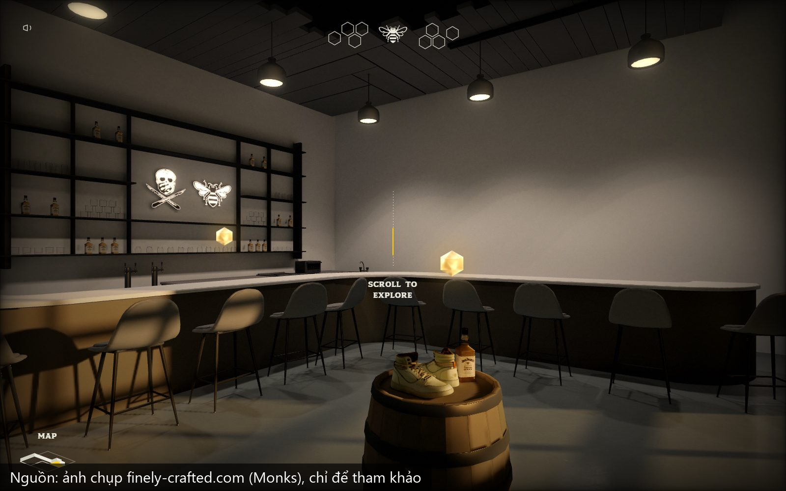

# reverse-3d-room

Skill cho Claude Code: mổ một web 3D đẹp bằng REA để biết vì sao nó nhìn thật, rồi dựng lại 1 phòng 3D chân thật bằng đồ miễn phí. Blender Cycles render sẵn từng khung theo đường camera, web cuộn là đi bộ trong phòng, bấm hotspot xem món đồ, deploy Vercel.


**Demo:** https://hollow-oak-lounge.vercel.app. Lounge whiskey hư cấu, 287 khung Cycles 1600x900, 3 hotspot. Làm lại theo công thức rút từ [finely-crafted.com](https://www.finely-crafted.com).

**Công cụ mổ web:** [REA (Reverse Engineer Anything)](https://github.com/morluto/rea), package npm `rea-agents`.

## Trước và sau

Bên trái là bản làm theo kiểu đưa link cho AI tự đoán (https://hem-showroom.vercel.app): tua video nên kéo bị giật, path trace trong trình duyệt nên ánh sáng nhảy. Bên phải là bản làm theo công thức REA rút ra.


Web mẫu đã mổ (ảnh chụp chỉ để tham khảo):



## Công thức rút ra từ Finely Crafted

1. Ánh sáng tính sẵn (Finely bake lightmap 4096x4096 bằng Bakery trong Unity), có ánh sáng dội và vệt nắng.
2. Sàn phản chiếu mờ, độ bóng loang không đều.
3. Camera ở tầm mắt người, 1,5 m.
4. Hậu kỳ nhẹ: tone map filmic, bloom ở đèn, vignette, grain.
5. Tường, sàn, nội thất phần lớn là màu phẳng. Texture chi tiết dồn cho vài món chính.

Chi tiết từng phát hiện kèm bằng chứng: [references/finely-recipe.md](references/finely-recipe.md).

## Quy trình

| Bước | Việc | Ai quyết |
|---|---|---|
| 0 | Chốt web mẫu, món chính, ngân sách giờ và tiền, cỡ màn hình đích | Bạn |
| 1 | Mổ web mẫu bằng REA qua Chrome có cổng debug | Claude |
| 2 | Báo cáo 3 ngăn: quan sát được, suy luận, chưa rõ | Claude |
| 3 | Plan + chi phí + 2 ảnh concept (Codex image gen) | **Bạn duyệt** |
| 4-5 | Tải đồ Poly Haven CC0, món chính bằng AI 3D nếu cần (tuỳ chọn, tốn phí) | **Bạn duyệt món chính** |
| 6 | Dựng cảnh Blender bằng script | Claude |
| 7 | Đánh đèn Cycles, seed test, 3 ảnh render thật cạnh web mẫu, kéo thử 24 khung | **Bạn duyệt** |
| 8 | Render cả loạt (chạy tiếp được khi bị ngắt) | Máy chạy |
| 9 | Đóng gói WebP + H.264, đo giật và nhảy sáng, chạy web local | **Bạn kéo thử** |
| 10 | Deploy Vercel | Claude |

<p>
  
  
</p>

## Số liệu thật của bản demo

| | |
|---|---|
| Thời gian bản đầu | khoảng 5,7 giờ làm, render máy tự chạy |
| Render | trung vị 30 giây/khung ở 1600x900 trên RTX 4050 laptop |
| Chi phí model AI | khoảng 0,87 USD (ảnh concept + 1 đôi giày 3D Hunyuan) |
| Kéo trên máy tính | p95 17 ms/khung, 0 lần khựng trên 50 ms |
| Nhảy sáng giữa 2 khung | dưới 0,1 mức xám trên 255 |
| Dung lượng tải | máy tính 20,5 MB, iPhone 4,3 MB (Finely 26,7 MB) |

Giới hạn còn lại (khung giãn trên màn rộng hơn cỡ render, tốc độ đi không đều ở đoạn quay người) ghi ở [references/pitfalls.md](references/pitfalls.md).

## Cài đặt

Cần: [Claude Code](https://claude.com/claude-code), Blender (đã chạy trên 5.2.1, cần bản 4.0 trở lên), Python có numpy, Pillow, playwright, ffmpeg, Node 22.18+, Google Chrome, Vercel CLI. Card NVIDIA giúp render nhanh hơn nhiều. Ảnh concept dùng [Codex CLI](https://github.com/openai/codex) đã đăng nhập.

Copy thư mục skill vào `~/.claude/skills/`:

```bash
# macOS / Linux
git clone https://github.com/thanhthuduc99/reverse-3d-room ~/.claude/skills/reverse-3d-room

# Windows (PowerShell)
git clone https://github.com/thanhthuduc99/reverse-3d-room "$env:USERPROFILE\.claude\skills\reverse-3d-room"
```

Mở Claude Code, gõ ví dụ:

```
Dùng REA reverse web https://www.finely-crafted.com, rồi làm cho mình 1 phòng 3D nhìn thật như vậy
cho quán cà phê. Lên plan, chi phí và ảnh concept trước.
```

Hoặc gọi thẳng `/reverse-3d-room`.

## Cấu trúc

```
SKILL.md                     quy trình 10 bước, 4 cổng duyệt
references/
  rea.md                     lệnh REA, khung báo cáo 3 ngăn
  finely-recipe.md           công thức Finely, so sánh render khung sẵn và bake lightmap
  pitfalls.md                bẫy đã gặp, số đo, giới hạn còn lại
scripts/
  re/                        shaders.js (tách GLSL từ bundle), scene.js (đọc cảnh nhúng JSON)
  blender/                   build_scene.py (cảnh mẫu Hollow Oak), walk.py (đường camera + hotspot),
                             common.py, render_setup.py, clean_ai_model.py, inspect_ph.py, cycles_gpu.py
  tools/                     fetch_ph.py, concept.py, fal3d.py, make_label.py, pack_frames.py, pack_h264.py,
                             flicker_scan.py, contact_sheet.py, serve.py, shoot_site.py, scroll_feel.py, capture_scroll.py
  render.cmd, xem-website.cmd
template/                    index.html (player cuộn: WebCodecs trên máy tính, WebP trên điện thoại), vercel.json
```

## Ghi chú

- Repo **không kèm bất kỳ asset nào của Finely Crafted** (code, ảnh, model, font, logo). Finely chỉ là web tham khảo để học cách làm. File tải về khi mổ web chỉ để phân tích, không dùng lại. DISCLAIMER của REA cũng ghi rõ điều này.
- Repo không kèm model, texture, file `.blend` hay khung render. Đồ nội thất tải từ [Poly Haven](https://polyhaven.com) (CC0) bằng `fetch_ph.py`.
- Hollow Oak là thương hiệu hư cấu. Khi làm web cho mình, đừng dùng logo hay nhãn thật của hãng khác.
- Model 3D AI (fal.ai Hunyuan) là tuỳ chọn có tốn phí, khoảng 0,57 USD/món (ảnh mẫu 0,04 + 3D có PBR 0,525) ở thời điểm 10/2026.

Tác giả: Thành Vũ Đức (Contentta). License MIT.
