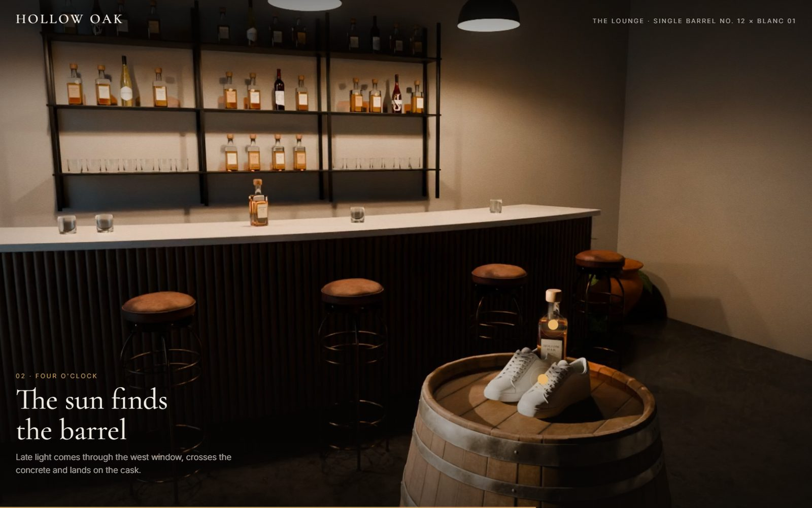
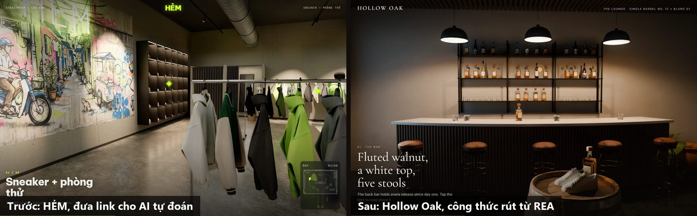
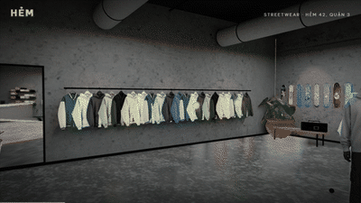
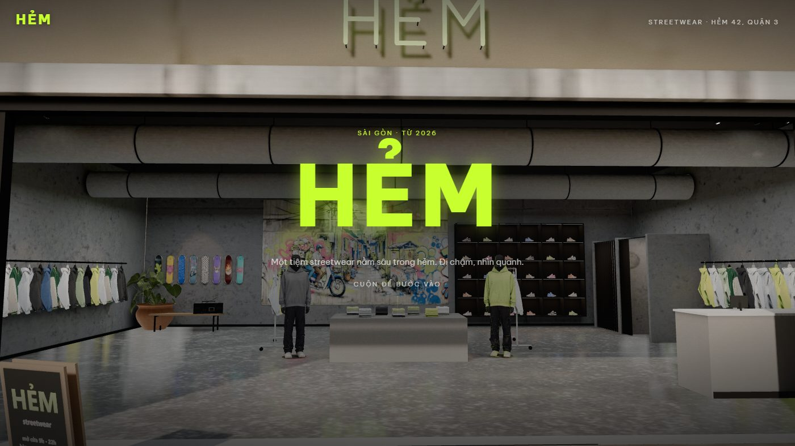
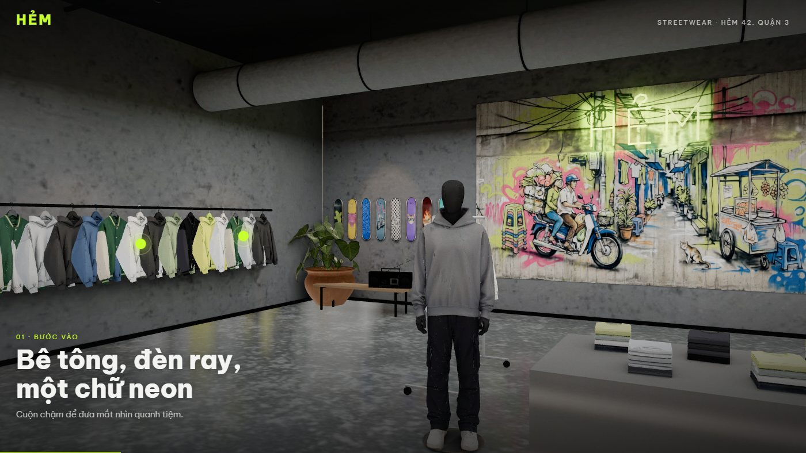
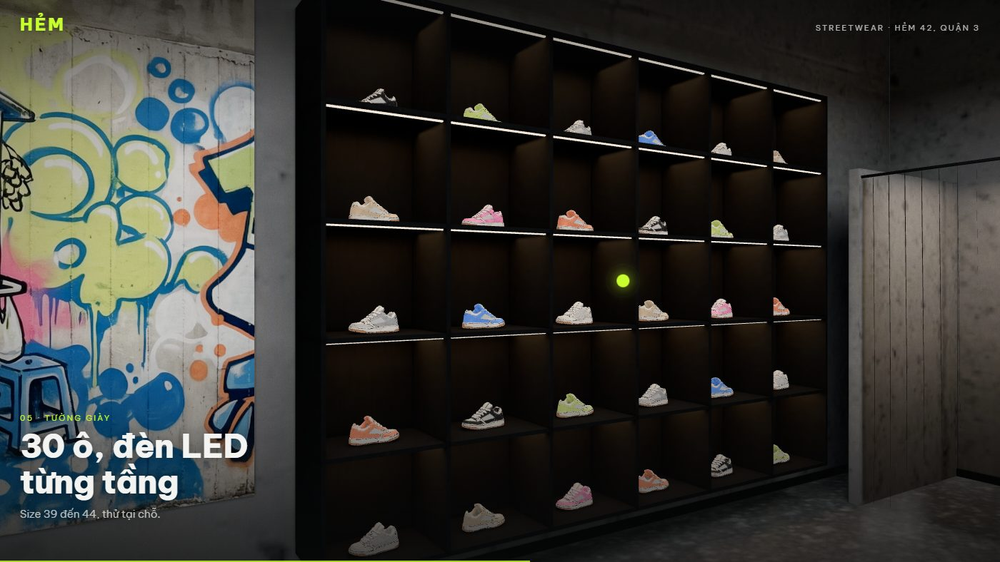
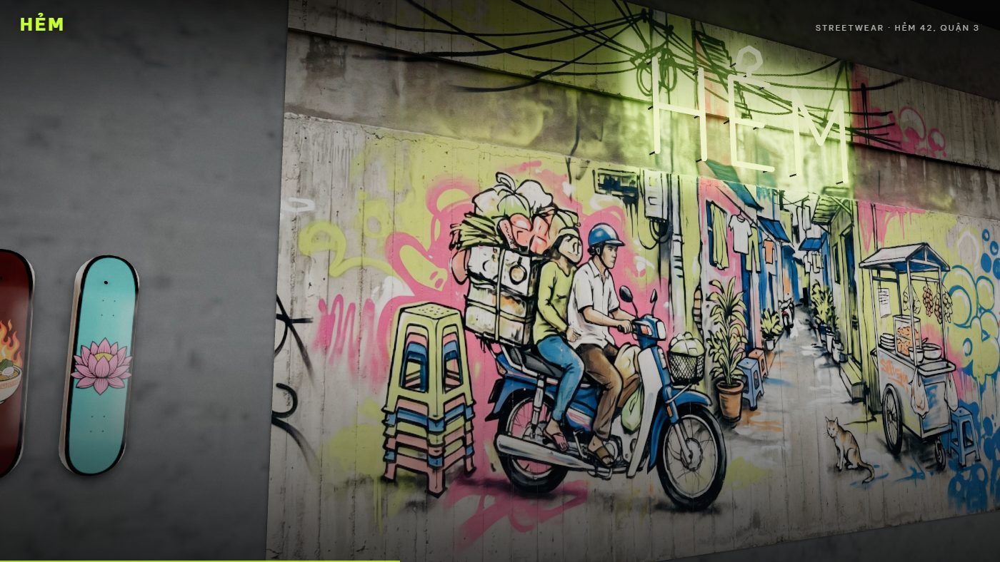
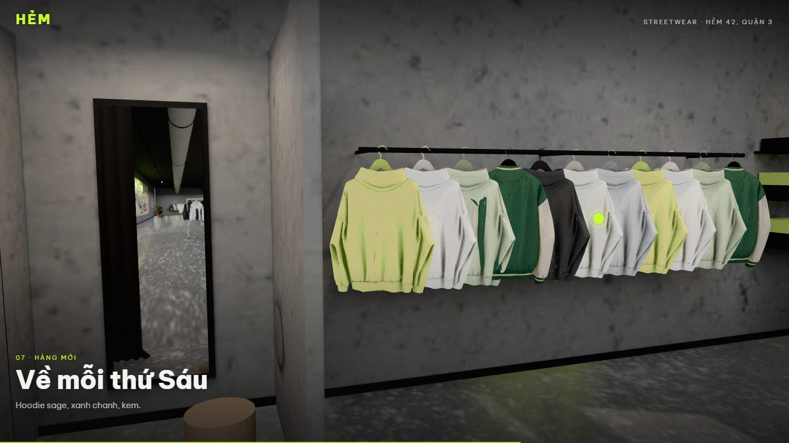
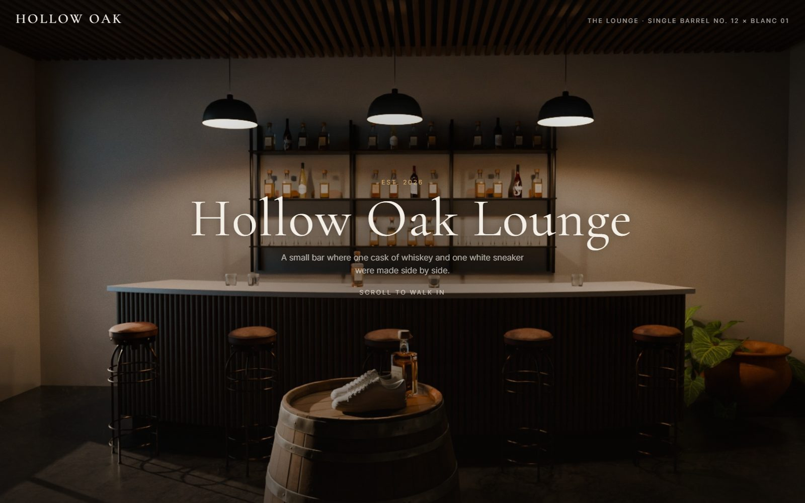
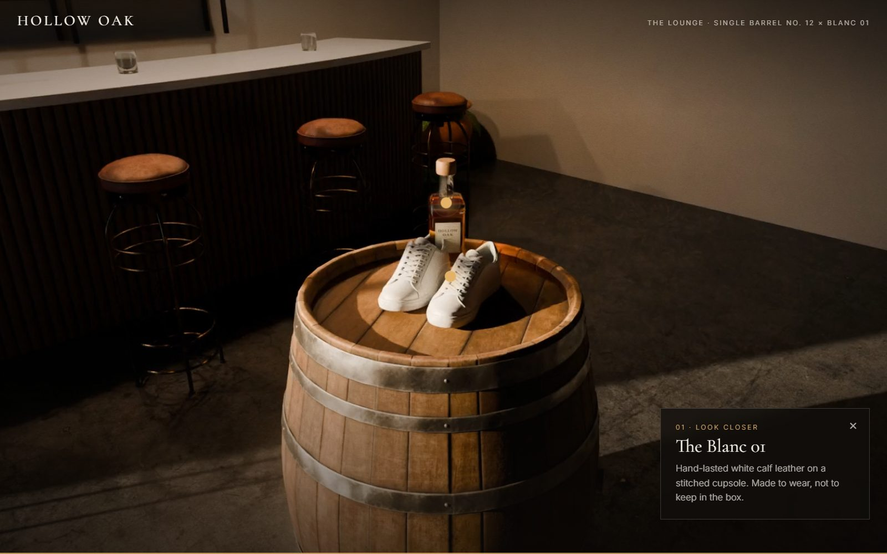

# showroom-3d-walk

Skill cho Claude Code: tạo 1 showroom, cửa hàng hay phòng 3D mới trên web, nhìn như ảnh chụp. Cuộn chuột là đi bộ quanh tiệm như khách bước vào, bấm hotspot xem món đồ và giá. Blender dựng cảnh bằng script với đồ miễn phí, Cycles bake ánh sáng, web WebGL vẽ lại phòng 60 khung/giây đúng độ phân giải màn hình (cách [finely-crafted.com](https://www.finely-crafted.com) làm), deploy Vercel.



**Demo:**
- https://hollow-oak-lounge-3d.vercel.app: lounge whiskey hư cấu, bản realtime (mặc định).
- https://hem-3d.vercel.app: tiệm streetwear HẺM 14x10 m, biến thể phòng lớn (lightmap + texture lặp).
- https://hollow-oak-lounge.vercel.app: bản cũ render sẵn 287 khung Cycles 1600x900 (hướng phụ).

Cả 3 là thương hiệu hư cấu. Bạn đưa loại tiệm, cỡ phòng, món chính; skill làm ra 1 showroom như 2 bản realtime ở trên.

## Trước và sau

Bên trái là bản làm theo kiểu đưa link cho AI tự đoán (https://hem-showroom.vercel.app): tua video nên kéo bị giật, path trace trong trình duyệt nên ánh sáng nhảy. Bên phải là bản làm bằng skill này.



## Ví dụ 2: HẺM, phòng lớn

Tiệm streetwear trong hẻm Sài Gòn, 14x10 m, trần 4,2 m. Camera đi 1 vòng chậm qua 13 điểm như người bước vào tiệm: đứng ngoài hẻm, qua cửa, kệ hoodie, góc skate, mural có chữ neon, tường giày, phòng thử, kệ hàng mới, quầy, rồi về bàn giữa.

<p>
  
</p>



<p>
  
  
</p>
<p>
  
  
</p>

Phòng lớn thì không bake màu vào texture như lounge được (1 atlas 4096 cho cả tiệm, tường bê tông sẽ nhoè). Cách làm:

| Thứ | Cách vẽ |
|---|---|
| Tường, sàn, trần | Texture lặp nét x lightmap chỉ chứa ánh sáng (UV thứ 2) |
| Quần áo, giày, ma-nơ-canh (model AI) | Texture gốc x ánh sáng bake theo từng đỉnh |
| Đồ scan nhỏ | Bake full màu như lounge |
| Neon, LED, gương, cây | Vẽ sống |

Số đo thật (laptop RTX 4050, nhưng Chrome vẽ bằng card Intel UHD, màn 1920x1080):

| | |
|---|---|
| Bake ánh sáng | 20 phút, 256 mẫu |
| Cuộn | trung vị 16,7 ms/khung (60 khung/giây), khoảng 1 đến 3% khung chậm hơn 25 ms |
| Dung lượng tải | khoảng 21 MB |
| Tiền AI cho bản này | 0 USD. Dùng lại 6 model 3D Hunyuan (khoảng 3,15 USD) từ bản cũ |

Bẫy đáng nhớ nhất: không khử răng cưa khi cuộn thì vạch đèn LED, thanh treo, mép áo nhấp nháy. Bật MSAA mọi khung thì card Intel không gánh thêm được phản chiếu sàn vẽ lại mỗi khung, nên sàn và gương đổi sang ảnh cube chụp phòng 1 lần lúc tải, chiếu theo khối hộp của phòng. Chi tiết ở [references/pitfalls.md](references/pitfalls.md).

## Vì sao nhìn thật

1. Ánh sáng tính sẵn bằng Cycles (bake), có ánh sáng dội và vệt nắng. Trình duyệt không tính ánh sáng nên không nhảy sáng.
2. Sàn phản chiếu mờ, độ bóng loang không đều.
3. Camera ở tầm mắt người, 1,5 đến 1,6 m, ống 24 mm.
4. Đồ nội thất là đồ scan thật (Poly Haven), món chính làm bằng AI 3D. Không dựng ghế, sofa bằng code.
5. Hậu kỳ nhẹ: tone map 1 lần, bloom ở đèn, vignette, grain. Khử răng cưa mọi khung.

Chi tiết: [references/recipe.md](references/recipe.md).

## Quy trình

| Bước | Việc | Ai quyết |
|---|---|---|
| 0 | Chốt loại tiệm, cỡ phòng, món chính, các khu trong tiệm, ngân sách giờ và tiền, cỡ màn hình đích | Bạn |
| 1 | Plan + chi phí + 2 ảnh concept (Codex image gen) | **Bạn duyệt** |
| 2-3 | Tải đồ Poly Haven CC0, món chính bằng AI 3D nếu cần (tuỳ chọn, tốn phí) | **Bạn duyệt món chính** |
| 4 | Dựng cảnh Blender bằng script | Claude |
| 5 | Đánh đèn Cycles, seed test, 3 ảnh render thật cạnh ảnh concept | **Bạn duyệt** |
| 6 | Bake ánh sáng (phòng nhỏ: bake màu; phòng lớn: lightmap + ánh sáng theo đỉnh). Máy chạy 15 đến 20 phút | Máy chạy |
| 7 | Web WebGL realtime, đo khung/giây trên đúng card và cỡ màn của bạn, chạy web local | **Bạn kéo thử** |
| 8 | Deploy Vercel | Claude |

<p>
  
  
</p>

## Số liệu thật

| | Hollow Oak (7x6 m) | HẺM (14x10 m) |
|---|---|---|
| Bake ánh sáng (RTX 4050 laptop, 256 mẫu) | 15 phút | 20 phút |
| Cuộn trên card Intel UHD, 1920x1080 | p95 17 ms/khung | p95 17 ms/khung, 1 đến 3% khung chậm hơn 25 ms |
| Dung lượng tải | khoảng 13 MB | khoảng 21 MB |
| Chi phí model AI | khoảng 0,87 USD (1 đôi giày) | khoảng 3,15 USD (6 model) |
| Hosting | Vercel Hobby miễn phí | Vercel Hobby miễn phí |

## Cài đặt

Cần: [Claude Code](https://claude.com/claude-code), Blender (đã chạy trên 5.2.1, cần bản 4.0 trở lên), Python có numpy, Pillow, playwright, ffmpeg, Node 22.18+, Google Chrome, Vercel CLI. Card NVIDIA giúp render nhanh hơn nhiều. Ảnh concept dùng [Codex CLI](https://github.com/openai/codex) đã đăng nhập.

Copy thư mục skill vào `~/.claude/skills/`:

```bash
# macOS / Linux
git clone https://github.com/thanhthuduc99/showroom-3d-walk ~/.claude/skills/showroom-3d-walk

# Windows (PowerShell)
git clone https://github.com/thanhthuduc99/showroom-3d-walk "$env:USERPROFILE\.claude\skills\showroom-3d-walk"
```

Mở Claude Code, gõ ví dụ:

```
Làm showroom 3D cho quán cà phê của mình, khoảng 8x6 m, món chính là máy pha espresso và quầy bánh.
Cuộn là đi bộ từ cửa vào tới quầy. Lên plan, chi phí và ảnh concept trước.
```

Hoặc gọi thẳng `/showroom-3d-walk`.

## Cấu trúc

```
SKILL.md                     quy trình 9 bước, 4 cổng duyệt
references/
  recipe.md                  vì sao nhìn thật, vì sao bản tự làm nhìn giả, 2 hướng làm
  pitfalls.md                bẫy đã gặp, số đo, giới hạn còn lại
scripts/
  blender/                   build_scene.py (cảnh mẫu Hollow Oak), walk.py (đường camera + hotspot),
                             bake.py (phòng nhỏ: bake màu), bake_lightmap.py (phòng lớn: lightmap + ánh sáng theo đỉnh),
                             build_shop_example.py (cảnh mẫu HẺM), common.py, render_setup.py, clean_ai_model.py,
                             inspect_ph.py, cycles_gpu.py
  tools/                     fetch_ph.py, concept.py, fal3d.py, make_label.py, pack_frames.py, pack_h264.py,
                             flicker_scan.py, contact_sheet.py, serve.py, shoot_site.py, scroll_feel.py, capture_scroll.py,
                             perf3d.py (đo khung/giây khi cuộn), shoot3d.py, gpu3d.py (Chrome đang dùng card nào), make_sign.py
  bake.cmd, bake_lightmap.cmd, render.cmd, xem-website.cmd
template/
  web3d/                     web realtime phòng nhỏ (three.js, vendor kèm sẵn)
  web3d-lightmap/            web realtime phòng lớn, MSAA mọi khung (dùng vendor của web3d)
  index.html                 hướng phụ: player khung render sẵn (WebCodecs trên máy tính, WebP trên điện thoại)
```

## Ghi chú

- Repo không kèm model, texture, file `.blend` hay khung render. Đồ nội thất tải từ [Poly Haven](https://polyhaven.com) (CC0) bằng `fetch_ph.py`.
- Hollow Oak và HẺM là thương hiệu hư cấu. Khi làm web cho mình, đừng dùng logo hay nhãn thật của hãng khác.
- Model 3D AI (fal.ai Hunyuan) là tuỳ chọn có tốn phí, khoảng 0,57 USD/món (ảnh mẫu 0,04 + 3D có PBR 0,525) ở thời điểm 10/2026.

Tác giả: Thành Vũ Đức (Contentta). License MIT.
